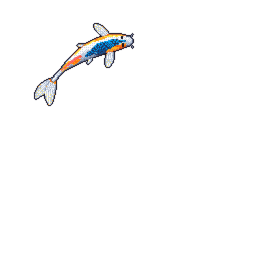

[About me placeholder]

---

### 🐟 My Weekly Koi

You might notice a koi fish swimming below! This isn't just a random animation; it's a unique, auto-generated reflection of my coding journey over the past week. 

Here is what the different features of the fish represent:
- Colors: Determined by the programming languages I have been using.
- Size and Growth: Reflects the volume of my recent contributions.
- Markings: Represent my current coding streaks.
- Movement: The way it swims is decided by the day of the week that just ended.

It serves as a fun, dynamic summary of my recent development journey.

